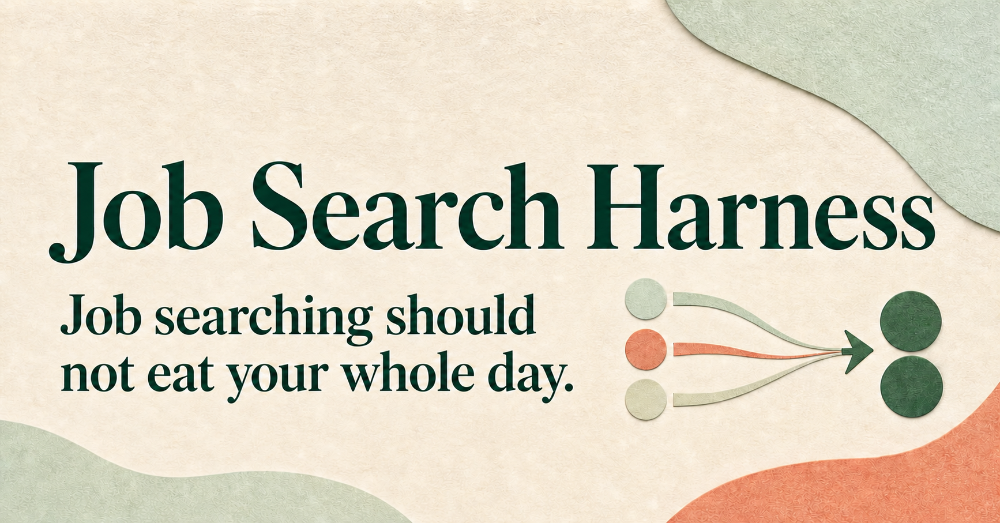
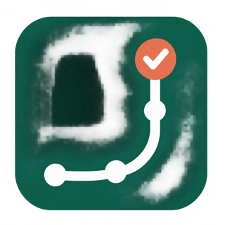

<div align="center">



</div>



# Job Search Harness

Job searching can get exhausting. You find the same role on three different sites, wonder if it is still open, tweak your resume again, and then try to remember which version you sent where. I built Job Search Harness to carry some of that repeat work.

It helps you **find and check open roles**, **see why they fit**, **prepare resume drafts using your real experience**, and **keep track of what happens**. You make the career decisions. The harness keeps the work moving.

**Ready to start?** [Open the guided walkthrough](https://productdave.github.io/Job-Search-OS/) to see the whole process in plain English, or [download the complete harness as a ZIP](https://github.com/productdave/Job-Search-OS/archive/refs/heads/main.zip) if you already have an AI app that can work with files.

## How do I get started?

You do not need to write code. You do need a computer and an AI app that can **read and edit files on that computer**. Codex, Claude Cowork or Claude Code, Cursor, and Visual Studio Code with an AI coding agent are examples. An ordinary chat window without file access can explain the method, but it cannot run your personal search.

### 1. Give the harness to your AI app

The easiest way is to paste this into your file-capable AI app:

```text
Please set up Job Search Harness from this repository:

https://github.com/productdave/Job-Search-OS

Use the installation method this AI app supports. When the toolkit is available, read INSTALL.md and job-search-os/references/getting-started.md. Walk me through the steps in plain English before asking for my personal details.

Create my job-search workspace in a separate private folder, outside the public repository. Let me review my profile and search settings before the first search. Don't apply or send messages for me.
```

If your app cannot install from the link, **[download the full harness as a ZIP](https://github.com/productdave/Job-Search-OS/archive/refs/heads/main.zip)** (or choose **Code → Download ZIP** above). Unzip it, open the extracted folder in your AI app, and paste this instead:

```text
I have downloaded and opened the Job Search Harness folder.

Please read INSTALL.md and job-search-os/SKILL.md. Then open job-search-os/references/welcome.html and guide me through setup in plain English.

Create my private job-search workspace in a separate folder. Do not put my personal information inside this public toolkit folder. Do not apply for jobs or send messages on my behalf.
```

The ZIP includes the whole toolkit. You do not need to download the three `.skill` files separately unless your AI app specifically uses standalone skills. [The installation guide](./INSTALL.md) covers that option.

<details>
<summary>My AI app asks for individual <code>.skill</code> files</summary>

Download the files your app asks for. GitHub cannot preview these packages, so use the instruction links if you want to read what each one does.

| Skill | Download | Read the instructions |
|---|---|---|
| Find and track roles | [Download](https://raw.githubusercontent.com/productdave/Job-Search-OS/main/job-search-os.skill) | [Read the instructions](./job-search-os/SKILL.md) |
| Tailor resumes | [Download](https://raw.githubusercontent.com/productdave/Job-Search-OS/main/resume-tailor.skill) | [Read the instructions](./resume-tailor/SKILL.md) |
| Maintain the workspace | [Download](https://raw.githubusercontent.com/productdave/Job-Search-OS/main/job-search-maintenance.skill) | [Read the instructions](./job-search-maintenance/SKILL.md) |

</details>

### 2. Start the walkthrough

When your agent says the toolkit is installed or open, send:

```text
Start my Job Search Harness onboarding. Show me the guide, teach me the steps from setup through the first manual run, then walk me through setup in plain English.
```

You can share a resume if you have one. The agent should ask about the roles you want, where you can work, your pay needs, and the experience and achievements you can verify. *“I’m not sure yet” is a perfectly good answer.* It should leave uncertain details as questions, not fill them in for you.

### 3. Check your setup and try one search

Before searching, review the **career facts**, **search preferences**, and **list of roles and applications** the agent creates. Correct anything that sounds wrong. Then ask for one search and look at the shortlist together.

The harness should check promising roles against the employer’s official listing, explain why each might fit, and flag what it could not confirm. You choose which roles to pursue. Resume drafts stay marked for **human review** until you have checked them, and you submit each application yourself.

After you apply, hear back, or interview, tell the agent what happened. That record helps the next search use what you have learned. Once you are happy with the first search, you can ask the agent to repeat it on a schedule.

## What does the harness help with?

1. **Find real opportunities.** Search for roles that match your goals and check whether promising listings are still open.
2. **Explain the fit.** See the reasons for a match and any gaps or uncertainties, so you can make the call.
3. **Prepare truthful drafts.** Tailor a resume from achievements you have confirmed, then review every claim and the finished document.
4. **Remember what happened.** Keep roles, applications, replies, and interview outcomes in one tracker so your search can improve over time.

The starter setup also includes public hiring-contact research and saved job descriptions. You can turn either off with your agent. The harness **does not apply for jobs or send outreach**. Some employer sites block verification, and features such as browsing, scheduling, spreadsheets, and document export depend on what your AI app supports.

## Where does my information go?

The public download contains **templates and fictional examples**. Your agent should create a **separate private folder** for your resume, preferences, tracker, and drafts. Check that folder before you start, and keep it out of any public GitHub repository. [Read the privacy guide](./PRIVACY.md) before publishing a fork.

## Already using the harness?

Follow [the update instructions](./INSTALL.md#updating-an-existing-installation). Ask your agent to keep your personal job-search folder separate and review any changes with you before running a scheduled search.

## Want to go deeper?

- [Guided first-use walkthrough](https://productdave.github.io/Job-Search-OS/) — the visual, step-by-step version of this page
- [Installation and update guide](./INSTALL.md) — more help with downloads, standalone skills, and your first run
- [Fictional example workspace](./examples/fictional-workspace/) — see what a completed setup looks like
- [Technical and maintainer guide](./MAINTAINERS.md) — files, automation, release steps, and architecture
